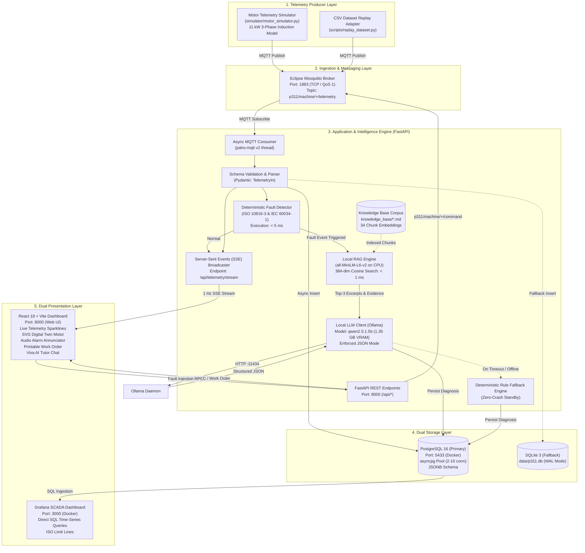
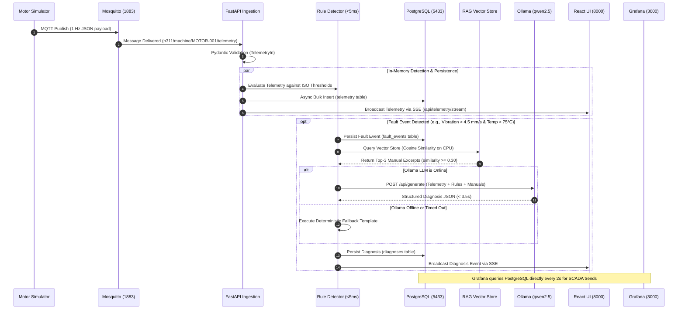
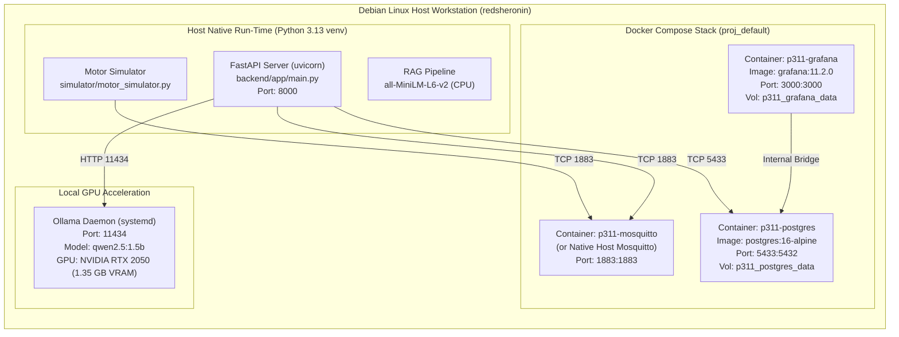
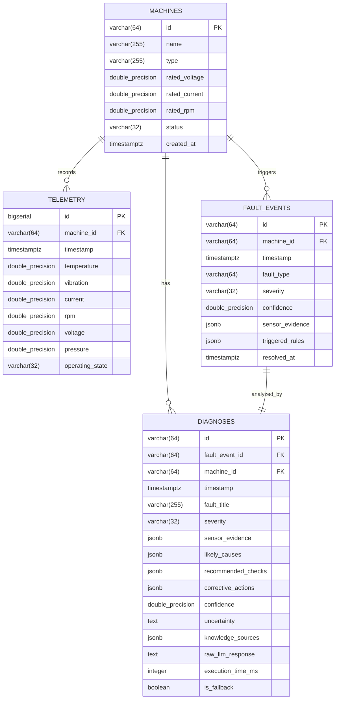
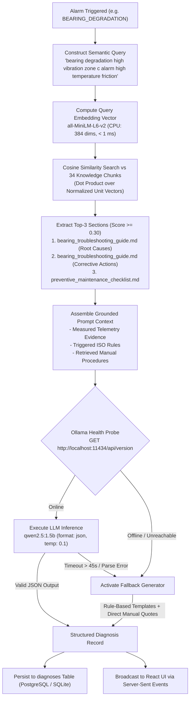

# System Architecture & Engineering Design
## Project P_311: Knowledge-Driven IoT Fault Diagnosis Assistant

---

## 1. Architectural Philosophy & Design Principles

The P_311 architecture is engineered around three core industrial tenets:
1. **Separation of Safety from AI Reasoning**: Emergency equipment shutdown and alarm triggers must be deterministic, mathematically verifiable, and instantaneous (< 5 ms). They must never depend on the non-deterministic latency or probabilistic output of a Large Language Model.
2. **Edge Autonomy (Zero Cloud Footprint)**: Telemetry streams, database storage, vector similarity search, and generative reasoning execute 100% locally on standard workstation hardware without external network dependencies.
3. **Dual Presentation Paradigms**: Complete division of operational time-series monitoring (Grafana SCADA) from interactive engineering root-cause analysis and academic defense (React Application).

---

## 2. Component Architecture Diagram

The following Mermaid diagram illustrates the interconnected software components, network ports, protocols, and data pathways of the implemented system:



---

## 3. End-to-End Data Flow Architecture

The data lifecycle proceeds through 5 distinct sequential stages:



---

## 4. Deployment Architecture

Project P_311 is deployed across a combination of containerized infrastructure services and host-native execution processes to maximize hardware efficiency and GPU acceleration:



---

## 5. Database Architecture & Schema Design

The storage layer implements a dual-database pattern:
- **Primary Database**: PostgreSQL 16 Alpine running in Docker, utilizing native `JSONB` data types for flexible storage of sensor evidence, triggered rule lists, recommended checklists, and manual citations.
- **Fallback Database**: SQLite 3 (`data/p311.db`) configured with Write-Ahead Logging (WAL) and synchronous normal mode, storing structured JSON as serialized text strings.

### 5.1 Entity-Relationship (ER) Diagram



---

## 6. MQTT Topic Hierarchy & Communication Protocol

The MQTT layer follows an industrial topic hierarchy organized by machine namespace:

```
p311/
└── machine/
    └── {machine_id}/
        ├── telemetry   (Publisher: Simulator/Sensors  -> Subscriber: Backend)
        ├── status      (Publisher: Simulator/Sensors  -> Subscriber: Backend / LWT)
        ├── command     (Publisher: Backend REST RPC   -> Subscriber: Simulator)
        └── fault       (Publisher: Simulator/Backend  -> Subscriber: SCADA Alarms)
```

### 6.1 Topic Specifications

| Topic Pattern | QoS | Direction | Retain | Description |
| :--- | :---: | :---: | :---: | :--- |
| `p311/machine/{id}/telemetry` | **1** | Producer $\rightarrow$ Backend | `false` | Continuous 1 Hz numerical sensor vector. |
| `p311/machine/{id}/status` | **1** | Producer $\rightarrow$ Backend | `true` | Node operational state (`running`, `stopped`, `offline`). Configured as MQTT Last Will and Testament (LWT). |
| `p311/machine/{id}/command` | **1** | Backend $\rightarrow$ Producer | `false` | Remote procedure call (`inject_fault`, `reset`, `start`, `stop`). |
| `p311/machine/{id}/fault` | **1** | Backend $\rightarrow$ SCADA | `false` | High-priority event notifications when safety limits trip. |

### 6.2 Sample Telemetry JSON Payload
```json
{
  "machine_id": "MOTOR-001",
  "timestamp": "2026-11-01T09:15:32.418Z",
  "temperature": 78.4,
  "vibration": 5.12,
  "current": 9.45,
  "rpm": 1478.2,
  "voltage": 229.8,
  "pressure": 4.15,
  "state": "warning"
}
```

---

## 7. AI Diagnosis & RAG Retrieval Pipeline

The diagnostic pipeline bridges quantitative physical alarms with qualitative engineering handbooks:


